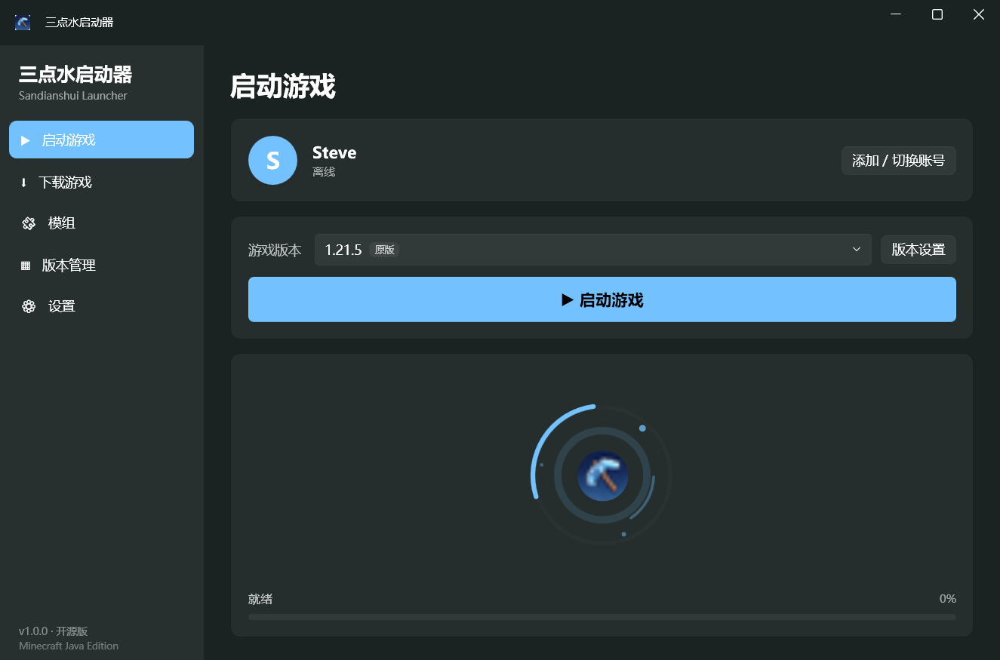
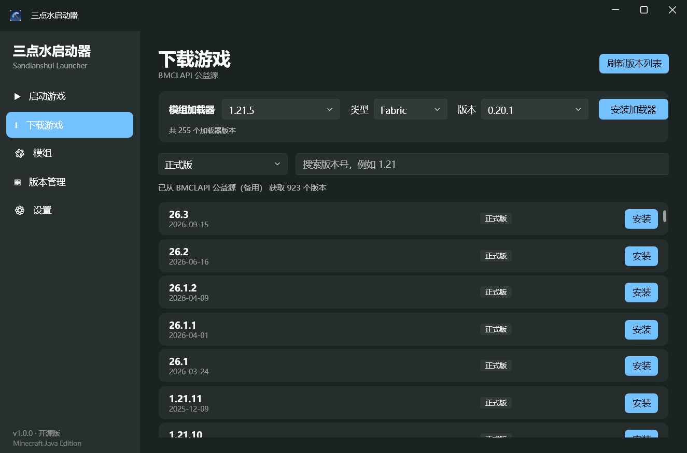
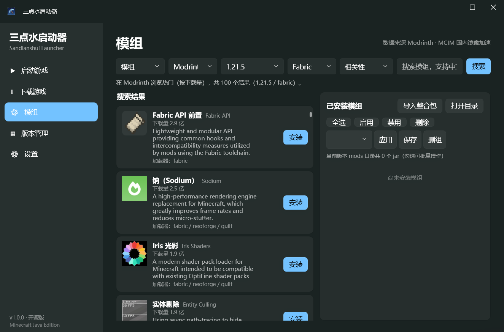
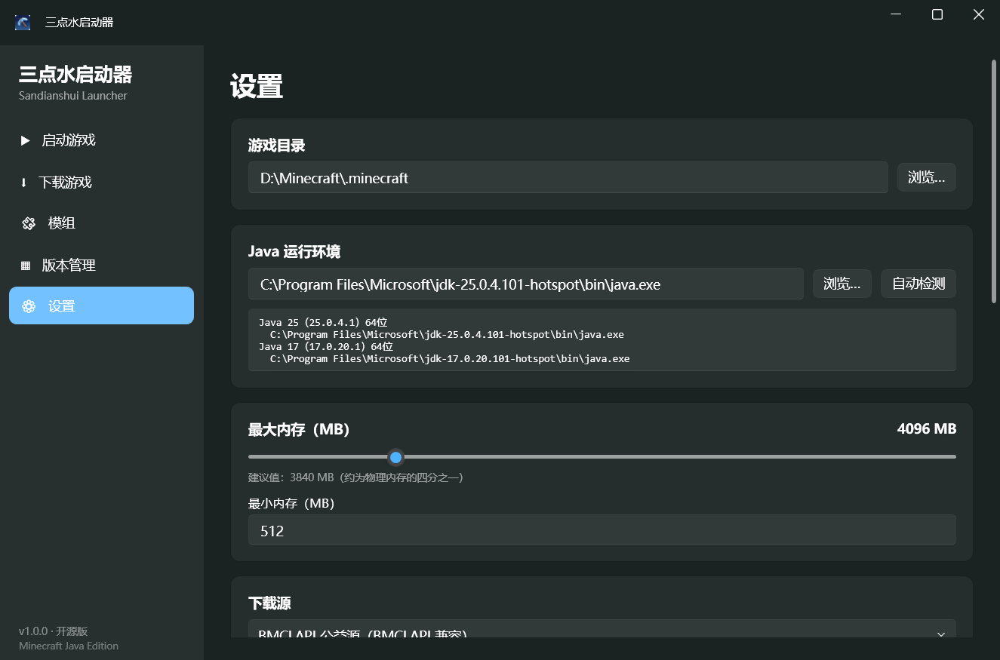

# 三点水启动器（Sandianshui Launcher）

一款面向 Windows 的 Minecraft Java 版第三方启动器，使用 **.NET 10 + WPF** 从零实现，界面与交互参考 [PCL2](https://github.com/PCL-Community/PCL2-CE) 的使用习惯，**不包含其任何代码副本**。

[](https://github.com/nosleep00/andianshui-launcher/actions/workflows/ci.yml)
[](LICENSE)
[](https://dotnet.microsoft.com/)

> 如果你 fork 了本项目，请把上面的徽章地址换成的你的仓库路径。

## 功能特性

**版本与启动**

- 在线安装任意正式版 / 快照 / 旧版本，多源自动回退（镜像 → BMCLAPI → Mojang 官方）
- 完整的版本继承（`inheritsFrom`）合并、新旧 natives 布局处理、游戏参数规则（`rules`）求值
- Java 自动检测与版本匹配，按版本单独覆盖内存、窗口大小、JVM 参数（版本隔离）
- 启动进度反馈、游戏进程监控、退出后自动收起启动器

**加载器**

- Fabric / Quilt / Forge / NeoForge 一键安装，自动从已装版本推断目标 Minecraft 版本
- 加载器与游戏版本不匹配时给出中文提示，而不是静默失败

**模组管理**

- Modrinth（默认走 MCIM 镜像）与 CurseForge 双平台搜索，支持中文关键词（自动映射英文术语）
- 安装时自动解析前置依赖（必需 / 可选），安装前按加载器挑选正确构建，避免「Forge 版本装进 Fabric 实例」
- 模组启用 / 禁用 / 删除，批量操作与「模组分组方案」保存、应用
- 模组更新检查、失效依赖提示、`.jar` 拖入窗口直接安装

**整合包**

- 一键导入 `mrpack`（Modrinth）与 CurseForge 整合包，自动创建隔离实例并按需下载加载器与模组
- 导入解压即玩的整合包目录（自动识别 `versions/`、`mods/`、`assets/` 等结构）
- 将本地实例导出为整合包 zip，便于分享

**账号与下载**

- 离线账号（用户名可留空，但未填用户名时不允许启动）、标准离线 UUID
- 外置登录（authlib-injector，兼容 LittleSkin 等皮肤站）
- 多线程分块下载器：SHA1 校验、失败重试、原子落盘、进度合并

**体验与诊断**

- Fluent 风格界面（WPF-UI）、首页环形动画与启动进度条、页面切换与导航过渡动画
- 游戏日志解析、崩溃专家系统诊断（含 Forge 模块解析、缺失依赖、Java 版本等常见问题）
- 启动日志与游戏输出落盘到 `%AppData%\SandianshuiLauncher\logs\`

## 截图

| 首页 | 下载游戏 |
| --- | --- |
|  |  |

| 模组管理 | 设置 |
| --- | --- |
|  |  |

## 下载

不想自己编译的话，直接到 [Releases](https://github.com/nosleep00/andianshui-launcher/releases) 下载：

| 产物 | 说明 |
| --- | --- |
| `SandianshuiLauncher-1.0.0-win-x64.zip` | 便携版，解压即用。**已自带 .NET 运行时**，无需另装 |

解压后双击 `SandianshuiLauncher.exe` 即可；配置、账号、日志都写在 `%AppData%\SandianshuiLauncher`，删除该目录即可恢复出厂状态。

## 系统要求

- Windows 10 1809 及以上 / Windows 11（x64）
- 运行：.NET 10 Desktop Runtime（或使用上面自带运行时的便携版）
- 构建：.NET 10 SDK，版本由 [global.json](global.json) 固定（当前 `10.0.403`）
- 游戏本体需自备正版账号（本启动器不提供游戏文件与账号）

## 构建与运行

```powershell
# 还原依赖
dotnet restore SandianshuiLauncher.slnx

# 运行全部单元测试
dotnet test SandianshuiLauncher.slnx

# Release 构建
dotnet build SandianshuiLauncher.slnx -c Release

# 启动
# src\SandianshuiLauncher\bin\Release\net10.0-windows\SandianshuiLauncher.exe
```

发布单文件自包含版本：

```powershell
dotnet publish src/SandianshuiLauncher/SandianshuiLauncher.csproj -c Release `
  -r win-x64 --self-contained true -p:PublishSingleFile=true -o publish
```

## 首次使用

1. 打开「设置」，确认**游戏目录**（默认 `%AppData%\.minecraft`，可改为任意目录）。
2. 「设置 → Java 运行环境」一般可保持自动检测；如检测失败，手动选择 `javaw.exe`。
3. 打开「账号」→ 添加离线账号并填写用户名（也可先留空，启动前再补）。
4. 打开「下载游戏」获取版本列表并安装；或把整合包 / 模组文件直接拖入窗口。
5. （可选）在「设置 → 模组下载」中填写 CurseForge API Key，用于自动下载 CurseForge 整合包内的模组：
   在 <https://console.curseforge.com> 免费申请后填入即可，**留空不影响其它功能**。

## 数据存放与隐私

- 所有配置、账号与日志仅保存在本机 `%AppData%\SandianshuiLauncher\` 下，**不上传任何数据、不含任何统计或遥测**。
- 账号令牌使用 Windows DPAPI（`TokenCrypto`）加密后再落盘。
- 网络请求只发往：所选下载源（BMCLAPI / 镜像 / Mojang 官方）、MCIM 镜像与 Modrinth API、CurseForge API、你配置的 authlib-injector 服务器。
- 日志中的访问令牌会在写入前做脱敏处理。

## 目录结构

```
SandianshuiLauncher/
├── SandianshuiLauncher.slnx          # 解决方案（.NET 10 新格式）
├── global.json                       # 固定 SDK 版本
├── LICENSE                           # GPL-3.0
├── src/
│   ├── SandianshuiLauncher.Core/     # 核心类库：模型 / 服务（下载、安装、启动、账号、崩溃分析）
│   └── SandianshuiLauncher/          # WPF 桌面应用：Views / ViewModels / Converters
├── tests/
│   ├── SandianshuiLauncher.Core.Tests/   # 核心逻辑单元测试
│   └── SandianshuiLauncher.App.Tests/    # ViewModel 与 XAML 结构测试
└── docs/                             # 设计与技术文档
    ├── 产品设计文档.md
    ├── PCL2-CE源码分析与技术方案.md
    └── images/                       # README 截图
```

## 开发约定

- 每次改动必须附带对应测试，交付前全量测试与 Release 构建必须通过；
- Core 层保持纯 BCL、零第三方依赖，网络与文件系统通过接口隔离以便测试；
- 用户可见的错误提示必须是中文，并说明「是什么问题 + 怎么办」；
- 提交信息使用 `feat/fix/refactor/test/docs/chore` 前缀。

## 已知限制与路线图

- 微软正版登录（Microsoft OAuth）尚未实现，目前仅支持离线账号与外置登录；
- 仅支持 Windows；
- 部分功能依赖第三方公益服务（BMCLAPI、MCIM 等），其可用性不由本项目保证。

## 致谢

感谢 [PCL2 社区版](https://github.com/PCL-Community/PCL2-CE) 在产品思路上的参考价值，以及 [BMCLAPI](https://bmclapi2.bangbang93.com/)、[MCIM](https://mod.mcimirror.top/)、[Modrinth](https://modrinth.com/)、[CurseForge](https://www.curseforge.com/)、[WPF-UI](https://github.com/lepoco/wpfui) 等开源项目与服务。

## 免责声明

- 本项目为第三方开源启动器，**与 Mojang Studios / Microsoft 无任何关联**，未获得其认可或授权；
- 使用本项目需要自行拥有合法的 Minecraft 账号与游戏文件；
- 因使用第三方镜像、API 或整合包导致的问题，由使用者自行承担。

## 许可证

本项目以 **GNU General Public License v3.0 or later** 发布，完整文本见 [LICENSE](LICENSE)。

你可以自由使用、修改与分发，但分发修改后的版本时必须以同一许可证开源，并保留版权声明与免责声明。
