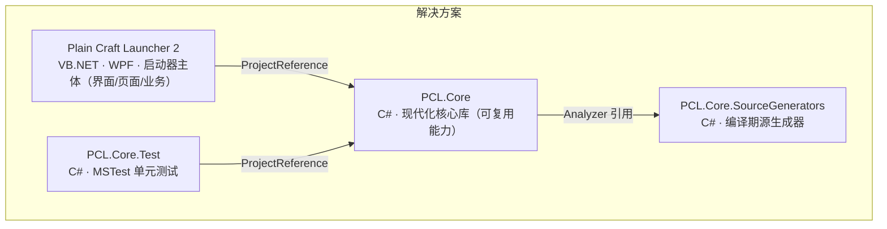
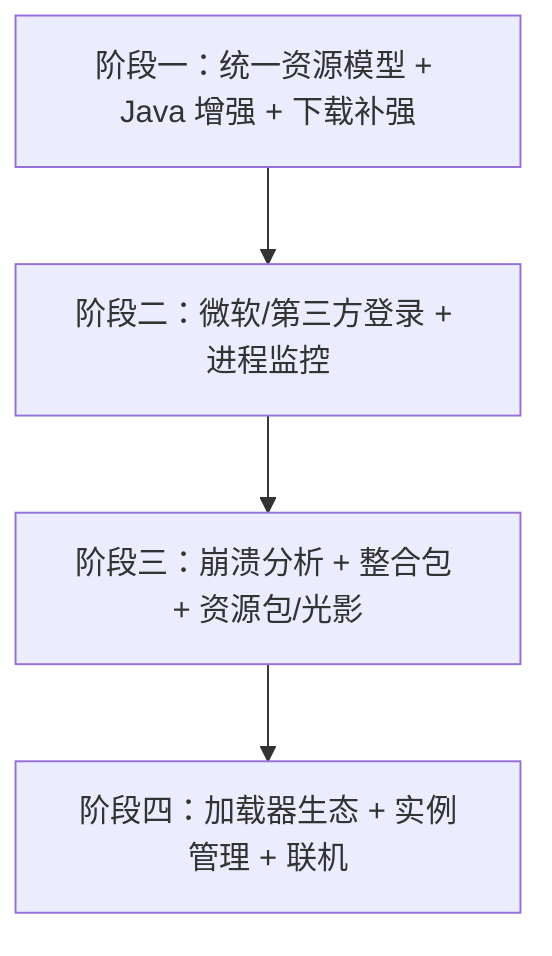

# PCL2 / PCL 社区版源码分析与技术方案

> 文档定位：通过分析业界成熟的 Minecraft Java 版启动器 PCL2 社区版（PCL-CE）的真实源代码，
> 提炼其架构分层、核心抽象与关键实现机制，并结合「三点水启动器」当前工程现状，
> 给出**可落地、有优先级、可验证**的对标演进方案。
>
> 编写日期：2026-11-03
> 分析对象：PCL-Community/PCL2-CE（Apache-2.0；启动器主体目录为自定义许可证）
> 分析方式：本地浅克隆真实代码后逐模块精读（非二手资料、非凭记忆推断）

---

## 目录

1. [背景与分析对象说明](#1-背景与分析对象说明)
2. [PCL-CE 整体架构分析](#2-pcl-ce-整体架构分析)
3. [核心模块与关键实现机制](#3-核心模块与关键实现机制)
4. [关键设计模式总结](#4-关键设计模式总结)
5. [三点水启动器现状对标](#5-三点水启动器现状对标)
6. [技术演进方案（分阶段、可落地）](#6-技术演进方案分阶段可落地)
7. [不建议照搬的部分](#7-不建议照搬的部分)
8. [许可证与合规注意事项](#8-许可证与合规注意事项)
9. [附录：参考资料](#9-附录参考资料)

---

## 1. 背景与分析对象说明

### 1.1 为什么分析的是社区版而不是 PCL2 主线

- **PCL2（Plain Craft Launcher 2）**：由独立开发者「龙腾猫跃」开发，是国内使用最广泛的
  Minecraft Java 版第三方启动器之一。其**主线完整源代码不公开**，无法直接作为代码分析对象。
- **PCL-CE（PCL Community Edition，社区版）**：基于 PCL2 已开源的代码进行社区二次开发，
  由社区开发者共同维护，包含主线尚未制作的功能与改进，源代码完全公开，是当前最权威、
  最活跃的可分析对象。
- 社区版官网：<https://pcl-community.github.io/PCL2-CE-Web/>
- 仓库规模（分析时）：约 5.0k stars、470 forks、约 4900 次提交。

### 1.2 技术演进脉络（重要）

PCL-CE 正处于一条清晰的「现代化迁移」路径上：

| 阶段 | 运行时 | 语言 | 特征 |
| --- | --- | --- | --- |
| 早期 | .NET Framework 4.8.1 | VB.NET | 单项目，所有逻辑写在 VB 模块里 |
| 当前分析版本 | .NET 8（`net8.0-windows`） | C# + VB.NET 混合 | 新增 C# 核心库 PCL.Core，VB 主体逐步迁移 |
| GitHub 最新主线 | .NET 10 | C# + VB.NET 混合 | 进一步拆出 PCL.Core.Wpf、PCL.Launcher.Core，采用 `.slnx` 解决方案格式 |

**对三点水的启示**：PCL 用了多年时间、靠社区力量才把 VB.NET 老代码逐步现代化。
而三点水从第一天起就采用 **C# + .NET 10**，没有历史语言包袱，这是后发优势，应坚持全 C# 路线。

### 1.3 运行平台

- 完整运行平台：Windows 10 1809（内部版本 17763）或更高，支持 x64 与 ARM64。
- 不支持 Windows 7 及以下。
- 可在 macOS / Linux 上用 .NET SDK 交叉编译，但只能在 Windows 上运行（强依赖 WPF）。

---

## 2. PCL-CE 整体架构分析

### 2.1 解决方案分层（本次精读版本，4 个工程）

各工程职责：

| 工程 | 语言 | 目标框架 | 职责 |
| --- | --- | --- | --- |
| `Plain Craft Launcher 2` | VB.NET | net8.0-windows，WPF，WinExe | 启动器主体：页面、自定义控件、业务模块 |
| `PCL.Core` | C# | net8.0-windows，WPF，启用 nullable/unsafe | 社区自研现代化核心库，承载可复用基础能力 |
| `PCL.Core.SourceGenerators` | C# | netstandard 类库 | Roslyn 增量源生成器，编译期生成样板代码 |
| `PCL.Core.Test` | C# | net8.0-windows | MSTest 单元测试（纯逻辑/工具类为主） |

> GitHub 最新主线在此基础上进一步把 WPF 相关代码拆到 `PCL.Core.Wpf`、
> 把启动器业务拆到 `PCL.Launcher.Core`，分层更细，方向是「通用基础库 + 业务核心 + 表现层」彻底解耦。

### 2.2 PCL.Core 核心库内部结构

PCL.Core 按**职责领域**划分目录，是一个组织良好的现代类库：

| 目录 | 职责 |
| --- | --- |
| `App/` | 应用层：IoC 生命周期、配置服务、任务中心、数据库抽象、命令行、单实例/更新/遥测等基础服务 |
| `IO/` | 输入输出：`Download`（新下载引擎 NDl）、`Net`（网络/套接字/转发）、`Storage`（存储） |
| `Minecraft/` | MC 领域：`Java`（检测/管理）、`Launch`（启动环境）、`ResourceProject`（CurseForge/Modrinth 模型）、`Yggdrasil`（认证） |
| `Link/` | 联机相关：EasyTier、Lobby 大厅、McPing、NAT 穿透等 |
| `Logging/` | 日志 |
| `UI/` | WPF 基础：控件、主题、动画、转换器、特效、媒体 |
| `Utils/` | 工具：编解码、加密、哈希、线程原语、扩展方法、OS、版本控制、诊断 |

### 2.3 VB 启动器主体结构

VB 主体采用「**模块（Module）+ 页面（Page）+ 控件（Control）**」的组织方式：

- `Modules/Base/`：基础模块 —— ModBase（通用工具）、ModNet（下载引擎）、ModLoader（任务编排）、
  ModAnimation（动画）、ModSetup、ModValidate。
- `Modules/Minecraft/`：MC 业务模块 —— ModMinecraft、ModLaunch（启动）、ModDownload（下载清单）、
  ModComp（组件）、ModLocalComp（本地组件）、ModJava、ModCrash（崩溃分析）、ModModpack（整合包）、
  ModProfile（账号/配置）、ModWatcher（监视器）、ModWorld（存档）、ModStyle（主题）。
- `Modules/` 顶层：ModMain（全局提示/对话框）、ModEvent、ModLink、ModMusic、ModSecret、
  ModWebServer、ModVideoBack、ModDevelop。
- `Pages/`：141 个页面文件，分 5 组 —— PageLaunch（启动主页）、PageDownload（下载）、
  PageInstance（实例/版本管理）、PageSetup（设置）、PageTools（工具）。
- `Controls/`：58 个自定义控件。

---

## 3. 核心模块与关键实现机制

以下机制均来自对真实源代码的精读，是 PCL-CE 最有学习价值的部分。

### 3.1 任务编排框架（LoaderBase / LoaderTask / LoaderCombo）

这是 PCL 自研的一套**工作流引擎**，贯穿启动、下载、安装等所有长流程。

- `LoaderBase`（抽象基类）：
  - 内置状态机：`Waiting → Loading → Finished / Failed / Aborted`。
  - 内置进度（0~1）与 `ProgressWeight`（权重，语义为预计耗时，用于汇总总进度）。
  - `Block`（是否阻塞后续任务）、`Show`（是否在界面显示）、`Start/Abort` 抽象方法、`WaitForExit` 同步等待。
- `LoaderTask(Of TInput, TOutput)`：单个任务，泛型输入/输出，执行体是一个委托。
- `LoaderCombo(Of TInput)`：组合加载器，按顺序管理多个子任务。

**编排机制（来自 LoaderCombo.Update 的真实逻辑）**：

- 前一个任务的 `Output` 会作为后一个任务的 `Input`（按泛型类型匹配），形成**流水线**。
- 已完成任务会被重新评估，输入条件变化时可自动重启。
- `Block=True` 的任务形成同步点；非阻塞任务可与后续任务并行。
- 全部子任务完成后，组合任务才标记完成。

启动流程就是用该框架组装的一条任务链：

### 3.2 下载引擎（NetFile / NetThread / NetSource）

PCL 有一套工业级自研下载引擎，能力非常完整：

- **多源管理与自动回退**：一个 `NetFile` 持有多个 `NetSource`（官方/各镜像），
  某个源失败时自动切换下一个源（`SourceFail` → `GetSource(nextId)`）。
- **多线程动态分片**：
  - 大文件在下载中动态分裂：找到最大未完成块，在其 40% 位置开新线程并行下载。
  - 对 BMCLAPI、GitHub、Modrinth、OptiFine 等特定源强制单线程（这些源对多连接不友好）。
  - 全局并发线程数有上限，避免占满网络。
- **断点续传**：线程中断后从 `起始位置 + 已完成长度` 处续传；线程以链表组织。
- **Range 回退**：服务器不支持分段请求时（`RangeNotSupportedException`）自动降级为单线程整文件下载。
- **分块合并（Merge）与文件校验（FileChecker）**：下载完成后合并分片并校验哈希/大小。
- **小文件保护与卡住检测**：线程卡住超过阈值允许重试，避免永久挂死。

> 三点水在 b9be23e 已实现多源回退、停滞超时、慢速看门狗、Content-Length 校验等健壮性能力，
> 方向与 PCL 一致；PCL 额外的「动态分片 + 断点续传」是后续可补强的进阶能力。

### 3.3 组件抽象（Comp）——统一资源模型

PCL 把所有可下载资源抽象为「组件（Comp）」，用一套模型处理多类资源：

- `CompType`：Mod、整合包、资源包、光影包、数据包、服务端插件、投影原理图、世界。
- `CompLoaderType`：Forge、NeoForge、Fabric、Quilt、LiteLoader、OptiFine、Iris、LabyMod 等。
- `CompSourceType`（位标志）：CurseForge、Modrinth，可同时启用。
- `CompSortType`：默认、相关性、下载量、关注量、最新发布、最近更新。
- 核心类：`CompProject`（项目）、`CompFile`（文件）、`CompProjectRequest`（请求，
  内含分别生成 CurseForge / Modrinth 请求地址的方法）。
- 本地用嵌入式数据库（LiteDB / SQLite）缓存组件数据，减少重复请求。

**价值**：新增一类资源（如资源包、光影）时，复用同一套搜索、列表、下载、缓存逻辑，而不必各写一套。

### 3.4 启动与登录认证

**登录方式（ModLaunch 中实现）**：

- **微软正版登录**：完整 OAuth 流程，分 6 个步骤（设备/授权码 → XBL → XSTS →
  获取访问令牌 → 检查 → 刷新），令牌可缓存与刷新。
- **第三方登录（authlib-injector）**：通过 `-javaagent` 注入 authlib-injector，
  并预取 Yggdrasil 元数据，支持外置登录服务器。
- **离线登录（Legacy）**：本地用户名直接进入。

**启动参数构造**：

- 区分**新旧版本**两套 JVM / 游戏参数构造（老版本用 `minecraftArguments` 字符串，
  新版本用 `arguments.jvm/game` 结构化规则）。
- 递归向上合并父实例（`inheritsFrom`）的参数，并用规则评估（`McJsonRuleCheck`）决定是否启用某条参数。
- 占位符替换（`${...}`）：`natives_directory`、`library_directory`、`game_directory`、
  `assets_root`、`auth_player_name/uuid/access_token`、`resolution_width/height`、`classpath` 等。
- Classpath 有特殊排序规则：Cleanroom 主 jar 必须在第一位、OptiFine 放在倒数第二位、支持自定义头部。
- 内置大量兼容性处理：Log4j 防御参数、老版本 RetroWrapper、UTF-8 代码页 Java Wrapper、
  软件渲染器（Mesa：llvmpipe/d3d12/zink）、代理设置、DPI 窗口尺寸修复等。

### 3.5 崩溃分析（ModCrash）——分级专家系统

崩溃分析是一套基于规则/关键字匹配的专家系统，分三级：

1. **Crit1 / Crit2（中高优先级）**：精准日志特征匹配（如内存不足、Java 版本不符、已知错误签名）。
2. **堆栈分析**：从崩溃报告 / MC 日志 / JVM 日志中提取堆栈关键字，再**反推导致崩溃的模组名称**。
3. **Crit3（低优先级）**：兜底的精准匹配。

最终输出人类可读的崩溃原因报告，并尽量定位到具体模组，降低玩家排查门槛。

### 3.6 进程监视器（Watcher）

游戏进程启动后，`Watcher` 负责持续监控：

- 实时读取游戏标准输出日志，按日志级别（FATAL/ERROR/WARN/INFO 等）着色。
- 检测游戏窗口是否出现、检测进程是否存活、判断是否崩溃。
- 汇总进度并在需要时主动结束进程。

### 3.7 整合包安装（ModModpack）

支持多达 7 种整合包格式，每种有专门安装器：CurseForge、Modrinth、HMCL、
MultiMC/Prism（MMC）、MCBBS、启动器专用格式、普通压缩包。
通用流程为：解压归档 → 读取 manifest → 复制 `overrides` 覆盖目录 → 按清单下载所需组件。

### 3.8 Java 检测与管理（Java 模块）

- 多种扫描器（`Scanner`）：注册表、默认安装路径、PATH 环境变量、`where` 命令、微软商店版本。
- 用 PE 头解析器（`PeHeaderParser`）读取 java.exe 的真实版本信息。
- 用户偏好策略：自动选择、指定已有版本、全局偏好、相对路径。
- 可根据 MC 版本自动匹配合适的 Java 主版本。

### 3.9 编译期源生成器（SourceGenerators）

基于 Roslyn `IIncrementalGenerator`，在编译期自动生成样板代码，包括：

- `ConfigGenerator`：根据特性标注的配置类生成配置访问代码。
- `DependencyCollectorGenerator`、`LifecycleScopeGenerator`、`LifecycleServiceTypesGenerator`：
  生成 IoC 依赖收集与生命周期服务注册代码。
- `EnvironmentInteropGenerator`：生成环境互操作代码。

**价值**：把大量重复的注册/包装代码交给编译器自动生成，减少手写样板，同时保持运行时高性能。

---

## 4. 关键设计模式总结

| 模式 / 机制 | 在 PCL-CE 中的体现 | 对三点水的价值 |
| --- | --- | --- |
| 状态机 | LoaderBase 的加载状态、游戏进程状态 | 长流程可控、可取消、可恢复 |
| 组合模式 | LoaderCombo 嵌套组合多个 Loader | 复杂流程可拼装、可复用 |
| 策略模式 | Java 扫描器、登录方式、渲染器、整合包安装器 | 同类能力可替换、易扩展 |
| 抽象工厂 / 统一模型 | Comp 组件抽象统一多类资源 | 新增资源类型成本低 |
| 责任链 / 回退 | 多下载源自动切换、崩溃三级匹配 | 提升成功率与容错 |
| 依赖注入 + 生命周期 | ILifecycleService（Start/Stop）、IoC 容器 | 解耦、便于测试 |
| 编译期代码生成 | Roslyn 源生成器 | 消除样板、保持性能 |
| 观察者模式 | 配置变更事件、状态/进度变更事件 | UI 与逻辑解耦 |

---

## 5. 三点水启动器现状对标

### 5.1 工程结构对标

| 维度 | PCL-CE | 三点水启动器 | 评价 |
| --- | --- | --- | --- |
| 语言 | C# + VB.NET 混合（有历史包袱） | 纯 C# | 三点水更现代，无迁移负担 |
| 运行时 | .NET 8（最新主线 .NET 10） | .NET 10 | 三点水已对齐最新 |
| UI 框架 | WPF | WPF | 一致 |
| MVVM | CommunityToolkit.Mvvm | CommunityToolkit.Mvvm + WPF-UI | 一致，且三点水多了现代 UI 库 |
| 工程分层 | 主体 + 核心库 + 源生成器 + 测试 | Core + WPF + Tests | 思路一致 |
| 测试框架 | MSTest | xUnit | 均为成熟框架，维持 xUnit 即可 |
| Core 依赖 | 含较多第三方包 | 纯 BCL 无第三方包 | 三点水 Core 更轻量、可移植性更好 |

### 5.2 功能能力对标

| 能力 | PCL-CE | 三点水现状 | 差距 |
| --- | --- | --- | --- |
| 版本下载 | 支持，多源 | 支持，光速/BMCL/官方多源回退 | 基本对齐 |
| 下载健壮性 | 多源、断点续传、动态分片 | 多源回退、停滞/慢速看门狗、完整性校验 | 缺动态分片与断点续传 |
| 游戏启动 | 完整，含大量兼容处理 | 完整，已真机验证 26.3 | 主流程对齐，兼容边角待补 |
| Java 管理 | 多扫描器、自动选择 | 已实现检测 | 可补多扫描器与自动选择 |
| 账号登录 | 微软/第三方/离线 | 离线 | 缺微软正版与第三方登录 |
| 模组 | 组件统一模型，多源 | MCIM/Modrinth 搜索安装，已真机验证 | 主流程可用，模型可统一 |
| 加载器 | 全系列（Forge/Fabric/Quilt/NeoForge 等） | Fabric/Forge，已真机验证 | 缺 Quilt/NeoForge 等 |
| 整合包 | 7 种格式 | 无 | 完全缺失 |
| 崩溃分析 | 三级专家系统 + 模组归因 | 无 | 完全缺失 |
| 进程监控 | Watcher 实时日志/窗口检测 | 基础启动等待 | 缺实时监控 |
| 资源包/光影 | 支持 | 无 | 完全缺失 |
| 联机 | EasyTier/大厅等 | 无 | 完全缺失（优先级低） |

---

## 6. 技术演进方案（分阶段、可落地）

按「**用户价值 × 实现成本 × 依赖关系**」排序，分四个阶段推进。每个阶段都遵循 AGENTS.md：
改动后同步编写/更新测试，交付前全量测试与 Release 构建通过，并创建对应 Git commit。

### 阶段一：巩固现有核心，补齐工程内可快速落地的能力

目标：在不引入大改动的前提下，把已有关键模块做扎实。

1. **统一资源模型（对标 Comp）**
   - 把现有「模组」抽象升级为通用资源模型，预留资源包、光影、数据包等类型枚举，
     让后续新增资源类型复用同一套搜索/下载/缓存逻辑。
   - 落地方式：先在 Core 定义通用接口与枚举，保持现有模组功能行为不变，再逐步迁移。
2. **Java 管理增强**
   - 增加多扫描器（注册表、默认路径、PATH、where），并按 MC 版本自动推荐 Java 主版本。
3. **下载引擎补强（可选，成本较高）**
   - 在现有多源回退基础上，增加分片下载与断点续传；优先保证逻辑可单测，网络部分用接口隔离。

### 阶段二：补齐账号与游戏监控闭环

1. **微软正版登录**（OAuth 设备码流程，令牌缓存与刷新）。
   - 这是正版用户的核心诉求，建议优先于第三方登录。
2. **第三方登录（authlib-injector）**：复用外置登录服务器。
3. **进程监视器 Watcher**：实时日志、日志级别着色、窗口检测、崩溃判定。
   - 与崩溃分析形成数据衔接。

### 阶段三：提升易用性与故障自愈

1. **崩溃分析专家系统**：先实现高命中率的精准特征规则库，再做堆栈关键字与模组归因。
2. **整合包安装**：优先支持最主流的 **CurseForge 与 Modrinth** 两种格式，
   验证稳定后再按需扩展 HMCL/MMC 等格式。
3. **资源包 / 光影包下载**：复用阶段一的统一资源模型，落地成本低、用户感知强。

### 阶段四：扩展加载器生态与高级功能

1. 补齐 **Quilt、NeoForge、OptiFine、LiteLoader** 等加载器/优化器安装。
2. 存档管理、版本隔离等实例化能力增强。
3. 联机功能（EasyTier/大厅）等差异化高级能力，优先级最低，视实际需求再投入。

### 演进路线示意

### 落地纪律（每个功能点统一执行）

1. 先在 Core 写纯逻辑并配 xUnit 单元测试（网络、文件系统用接口隔离 + 假实现）。
2. 再在 WPF 层接 ViewModel 与页面，保持 MVVM、UI 与逻辑解耦。
3. 真机验证关键路径（在本机任意的 Minecraft 游戏目录中进行）。
4. 全量测试 + Release 构建通过后，用 Git 完整路径提交对应 commit。

---

## 7. 不建议照搬的部分

学习 PCL 不等于照抄，以下部分应主动规避：

1. **VB.NET 的全局 Module 与全局可变状态**
   PCL 大量使用 VB Module（等价静态类）共享全局状态，模块间隐式耦合、难测试。
   三点水应坚持依赖注入 + 显式服务，避免全局静态状态。
2. **过度自研、重复造轮子**
   PCL 因历史原因自研了命令行、JSON 动态封装、线程池等。现代 .NET 已有成熟 BCL 与官方扩展，
   三点水应优先使用框架能力，仅在确有必要时自研（如下载引擎的分片调度）。
3. **沉重的第三方依赖堆叠**
   PCL.Core 引入了较多 NuGet 包。三点水 Core 目前保持「纯 BCL、零第三方依赖」，
   这是可移植性与可测试性的优势，新增依赖应谨慎、能不用就不用。
4. **历史兼容代码的复杂度**
   PCL 内有大量针对极端老旧版本、特殊环境的兼容分支。三点水可先聚焦主流版本，
   兼容逻辑按真实需求逐步添加，避免过早背上复杂度。
5. **直接复制代码**
   启动器主体目录为自定义许可证，且代码语言/架构不同。应学习**设计思路与机制**，
   用三点水自己的 C# 架构重新实现，而非粘贴代码。

---

## 8. 许可证与合规注意事项

1. PCL-CE 的许可证**按目录划分**：
   - `Plain Craft Launcher 2/` 目录使用**自定义许可证**，使用与复用需遵守其单独条款。
   - 其余所有目录（含 PCL.Core）使用 **Apache License 2.0**。
2. 三点水在借鉴 Apache-2.0 部分时，若分发相关代码/产物，应保留版权声明、许可声明与 NOTICE，
   并注明修改情况。
3. 本项目以**学习设计思想、独立实现**为主，不直接拷贝受自定义许可证约束的主体代码，规避授权风险。
4. Minecraft 本身的商标、游戏资源与最终用户协议归 Mojang/Microsoft 所有，
   启动器应避免分发受版权保护的游戏本体文件，仅提供下载与启动能力。

---

## 9. 附录：参考资料

| 资料 | 地址 |
| --- | --- |
| PCL-CE GitHub 仓库 | <https://github.com/PCL-Community/PCL2-CE> |
| PCL-CE Gitee 镜像 | <https://gitee.com/pcl-community/PCL2-CE> |
| PCL2 社区版官网 | <https://pcl-community.github.io/PCL2-CE-Web/> |
| 腾讯云开发者社区：PCL Community Edition 介绍 | <https://developer.cloud.tencent.com/article/2760028> |
| PCL2 完全开源版（源码恢复版，参考） | <https://cortexax.github.io/PCL/> |

> 说明：本方案中所有关于 PCL-CE 的目录、框架、依赖与实现机制描述，
> 均基于本地浅克隆代码的实际精读；三点水现状部分基于当前工程真实结构。
> 后续如上游仓库结构发生变化，应以最新代码为准重新核对。
